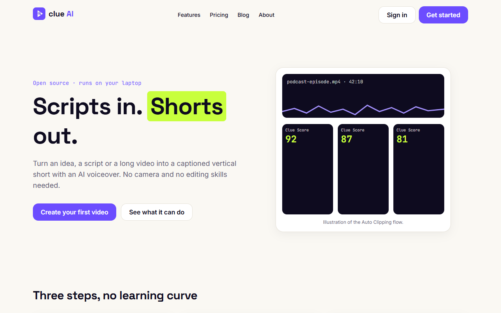
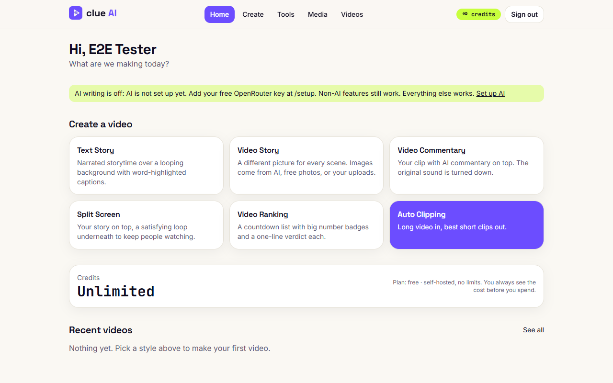
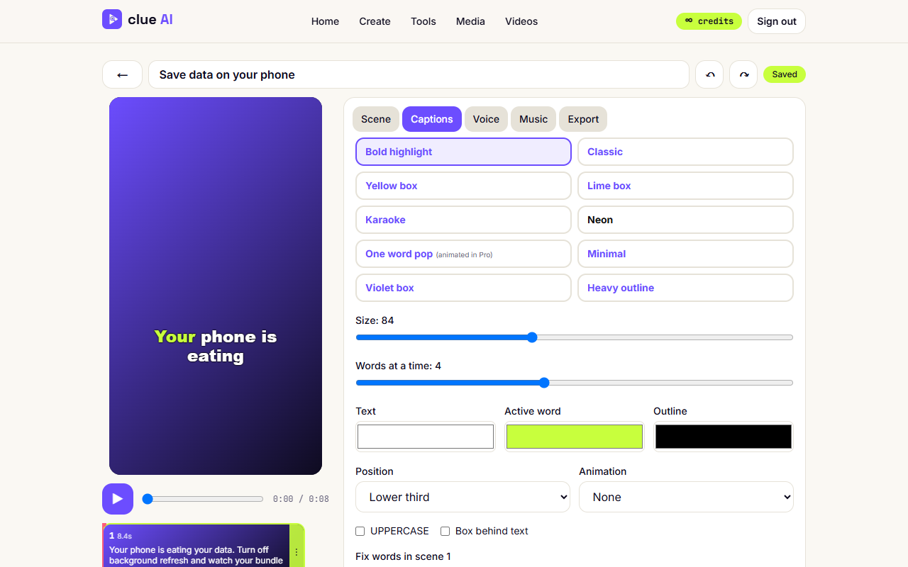
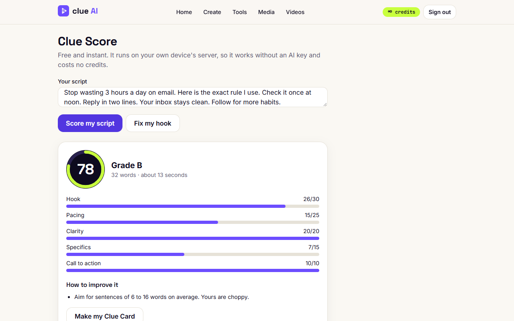
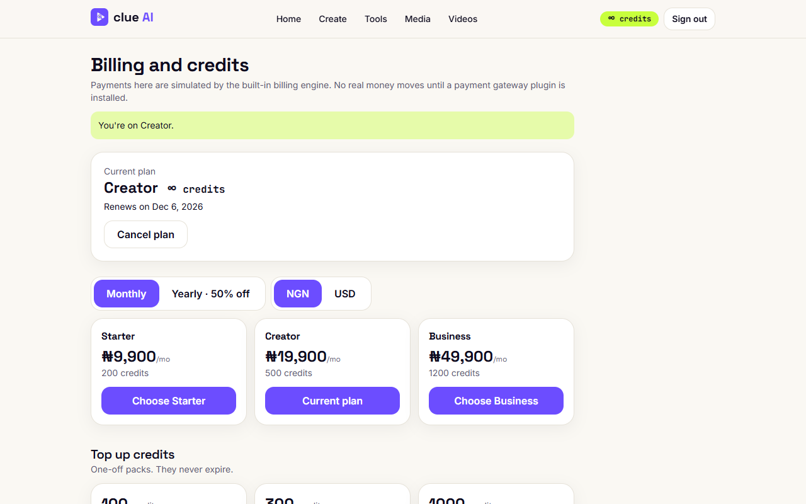
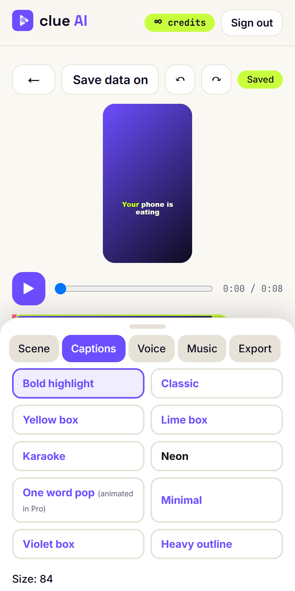
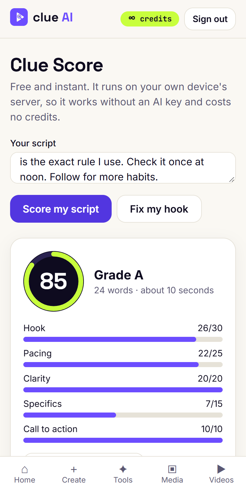
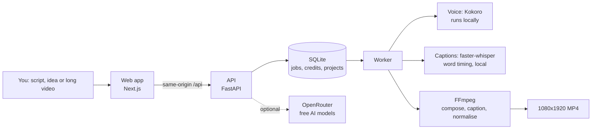

<div align="center">


# Clue AI

**Scripts in. Shorts out.**
Turn an idea, a script or a long video into a captioned vertical short with an AI voiceover.
No camera. No editing skills. Runs on your own laptop.

[](https://github.com/Kennedy200/clue-ai/actions/workflows/ci.yml)
[](LICENSE)


<br/>



</div>

---

## What is Clue AI?

Short vertical videos (TikTok, Reels, YouTube Shorts) win attention, but making them is slow. **Clue AI makes them for you**: write or paste a script (or let AI write one), pick a style, and get a 1080×1920 MP4 with a natural voice and word-by-word captions in minutes.

It is built to be **free to run and easy to own**:

- **No accounts to create, no keys to buy.** The only optional key is a *free* [OpenRouter](https://openrouter.ai) key for the AI-writing features. Without it, everything else still works.
- **Voice and speech run on your own computer** (Kokoro for voices, faster-whisper for transcription, FFmpeg for video). Nothing is sent to a paid service.
- **Made with Nigerian creators in mind**: prices in naira first, data-light, and works well on a phone.
- **Open source (MIT).** Use it, change it, sell it.

---

## See it

<table>
<tr>
<td width="50%"><br/><sub><b>Pick a style.</b> Six video types plus Auto Clipping.</sub></td>
<td width="50%"><br/><sub><b>Edit like a pro.</b> Live preview, 10 caption styles, timeline, undo and redo.</sub></td>
</tr>
<tr>
<td width="50%"><br/><sub><b>Clue Score.</b> Free, instant 0 to 100 score for any script, with exact tips.</sub></td>
<td width="50%"><br/><sub><b>Credits and plans.</b> Built-in billing, invoices, top-ups and referrals.</sub></td>
</tr>
</table>

<div align="center">

| Made on a phone | | What you get |
|:--:|:--:|:--:|
|  |  |  |
| The whole editor fits a 360 px screen | Mobile-first from day one | Real output: 1080×1920, word-highlighted captions |

</div>

---

## What you can make

| | |
|---|---|
| **Text Story** | Narrated storytime over a looping background with word-highlighted captions |
| **Video Story** | A different picture for every scene (free photos, AI images or your uploads) |
| **Video Commentary** | Your clip with commentary on top; the original sound is turned down |
| **Split Screen** | Your story on top, a satisfying loop underneath |
| **Video Ranking** | A countdown list with big number badges |
| **Auto Clipping** | Long video in, best short clips out: transcribed, ranked with reasons, reframed to 9:16 (follows the face), captioned |

Plus: **Clue Score** and **Fix my hook**, **title scorer**, **idea generator**, **script enhancer**, **thumbnail maker**, **transcriber** (SRT and VTT), **brand kits**, **bulk creation from a CSV**, a **content calendar** with a publish pack, **teams**, **analytics**, and an **admin panel** with Excel import and export.

---

## Quick start

You need three things installed first:

| Requirement | Windows | macOS | Linux |
|---|---|---|---|
| **Node.js 20+** | [nodejs.org](https://nodejs.org) | `brew install node` | your package manager |
| **Python 3.12** | [python.org](https://www.python.org/downloads/) (tick *Add to PATH*) | `brew install python@3.12` | `sudo apt install python3.12 python3.12-venv` |
| **FFmpeg** | `winget install Gyan.FFmpeg` | `brew install ffmpeg` | `sudo apt install ffmpeg` |

Then, in a terminal (Git Bash, PowerShell, Terminal):

```bash
# 1. Get the code
git clone https://github.com/Kennedy200/clue-ai.git
cd clue-ai

# 2. Install everything (Python packages, web packages, voice model, database, demo users). 5 to 10 minutes the first time.
npm run setup

# 3. Start the app
npm run dev
```

When it is ready you will see this table (your demo passwords will differ):

```
Clue AI is running
  App ........... http://localhost:3000
  Admin ......... http://localhost:3000/admin
  Setup (key) ... http://localhost:3000/setup
  API docs ...... http://localhost:8000/docs
  Dev inbox ..... http://localhost:3000/dev-mail
  Demo login .... demo@clue.local / <printed for you>
  Admin login ... admin@clue.local / <printed for you>
```

Open the **App** link, sign in with the demo login (or create your own account), choose **Text Story**, paste a few sentences and press **Create**. Your first video appears in about a minute.

> **Tip:** the first video downloads the speech-recognition model once (about 460 MB for the default `small`). To start faster on a slow connection, set `WHISPER_MODEL=tiny` in `.env`.

### Optional: turn on the AI-writing features (free)

1. Make a free account at [openrouter.ai](https://openrouter.ai) and create an API key.
2. Sign in as **admin**, open **Setup** and paste the key. It is stored encrypted on your computer and never leaves it except to talk to OpenRouter.
3. Check that everything works: `npm run verify:llm`

Without a key the app still boots, and videos, voices, captions, the editor, Clue Score, billing and the admin panel all work. Only idea generation, AI script planning, title scoring and AI clip scoring need the key.

### Everyday commands

| Command | What it does |
|---|---|
| `npm run setup` | Install and prepare everything (safe to run again) |
| `npm run dev` | Start the API, the video worker and the website, and print the links table |
| `npm test` | Run the backend tests and the web type-check and unit tests |
| `npm run test:web` | Run the browser end-to-end tests (needs the app running) |
| `npm run scan` | Scan the code for secrets. Run before every push |
| `npm run verify:llm` | Test the AI features against your OpenRouter key |
| `python -m clue.backup create` | Back everything up (run from `apps/api`) |

---

## How it works



- **One scene file drives everything.** The editor preview in your browser and the FFmpeg render read the same "scene JSON", so what you see is what you get.
- **Credits are a ledger.** Every spend is reserved first, settled on success and refunded on failure. Balances can never go negative.
- **Local first.** Jobs run from a database queue, so a crash never loses a paid video.

More detail: [docs/ARCHITECTURE.md](docs/ARCHITECTURE.md).

---

## Two ways to run it

| | `APP_MODE=self_host` (default) | `APP_MODE=saas` |
|---|---|---|
| For | You, on your own computer | A public website with paying users |
| Credits | Unlimited | Plans, top-ups, referrals |
| Watermark | None | Free plan only |
| Email | Local inbox at `/dev-mail` | Real email through SMTP |
| Database | SQLite | SQLite, or PostgreSQL-compatible |

Pricing in `saas` mode (naira first, dollars too; yearly is 50% off): **Free** · **Starter ₦9,900** · **Creator ₦19,900** · **Business ₦49,900** per month. A Fast video costs 5 credits, Pro 8, Cinematic 14.

---

## Deploy to a server

A rented Linux server (4 vCPU, 8 GB), a domain and Docker are enough. Caddy gets the HTTPS certificate by itself.

```bash
git clone https://github.com/Kennedy200/clue-ai.git && cd clue-ai
cp infra/.env.production.example .env        # set DOMAIN, ADMIN_EMAIL and the SMTP lines
docker compose -f infra/docker-compose.yml --env-file .env up -d --build
```

Full step-by-step (about 30 to 45 minutes), backups, restore and troubleshooting: **[docs/RUNBOOK.md](docs/RUNBOOK.md)**.

---

## Extend it

Drop a folder with a `manifest.json` into `plugins/<kind>/<name>/` and it appears in **Admin → Plugins**. Shipped plugins: SMTP email, Piper voices (11 local voices), edge-tts (Nigerian English, needs internet). See [docs/PLUGINS.md](docs/PLUGINS.md).

## Documentation

| | |
|---|---|
| [docs/ARCHITECTURE.md](docs/ARCHITECTURE.md) | How the pieces fit together |
| [docs/RUNBOOK.md](docs/RUNBOOK.md) | Deploy, back up, restore, fix problems |
| [docs/COSTS.md](docs/COSTS.md) | Measured render times, cost per video, margin per plan in naira |
| [docs/PLUGINS.md](docs/PLUGINS.md) | Write and install plugins |
| [docs/LICENSES.md](docs/LICENSES.md) | Licences of the models, voices and tools used (read before selling) |
| [docs/PLAN.md](docs/PLAN.md) | Build log, phase by phase, with what was verified |
| [SECURITY.md](SECURITY.md) | Security checklist and how to report a problem |

---

## Honest status

This is a complete, tested application, and these are the things **not yet verified**. Please read them before relying on it:

- **AI features were tested with fake providers only.** Ideas, script planning, title score, enhancer, Fix my hook and AI clip scoring have not been run against a real OpenRouter key. Run `npm run verify:llm` and open an issue if anything fails.
- **Payments are simulated.** The billing engine, invoices and renewals are real and tested, but no money moves until you add a payment-gateway plugin.
- **YouTube upload was tested against a mock** of Google, not the real service. The publish pack (copy title, description and hashtags) works for every platform.
- **The Docker files have not been run on a real server.** Expect to fix a small thing or two and please send it back.
- **Speed:** Home and Pricing score about 87 on Lighthouse mobile on a slow laptop (accessibility 100). The 90 target is not met yet.
- **Not built yet:** Cinematic light-leak transitions and sound effects, a built-in music library, two-factor sign-in.
- **Legal pages are templates.** Have a lawyer review them before you launch publicly.
- Free OpenRouter models allow roughly 20 requests a minute and 50 a day.

What *is* verified: 124 backend tests, 11 web unit tests, browser end-to-end tests on desktop and a 360 px phone, WCAG 2.1 AA checks on 28 pages with no console errors, a security review with fixes, and a backup restored on a live database.

---

## Contributing

Issues and pull requests are welcome. Read [CONTRIBUTING.md](CONTRIBUTING.md) and our [Code of Conduct](CODE_OF_CONDUCT.md). Run `npm test` and `npm run scan` before you open a pull request. Never commit a `.env` file or a key: the scanner will stop you, and so will CI.

## License

MIT. See [LICENSE](LICENSE). Clue AI is an independent project and is not affiliated with any other video product.

<div align="center"><sub>Built with FastAPI, Next.js, SQLite, FFmpeg, Kokoro, faster-whisper and OpenCV.</sub></div>
